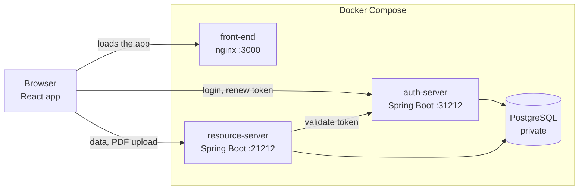
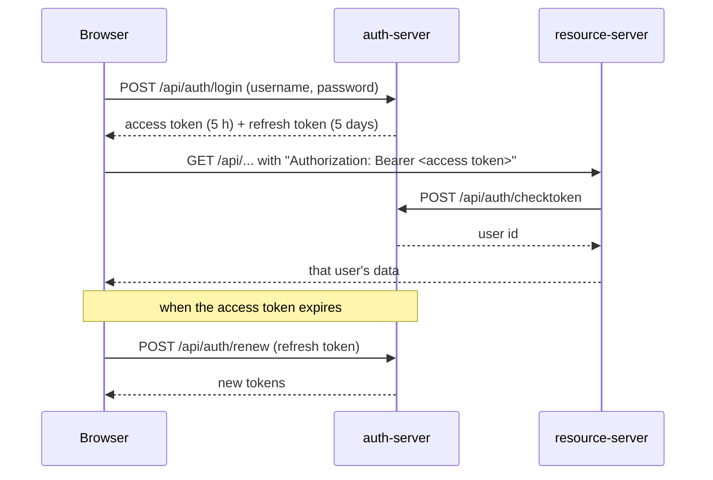

# Koolitrek

**Turn school report PDFs into clear progress charts.**

Koolitrek is a full-stack web application for students in Estonia. Upload the marks sheet you download from **eKool** (the national school e-diary), and Koolitrek reads the PDF, extracts every subject's marks and your absences, and shows how your averages change across school years and periods.

It is built as three services — a React frontend, a JWT authentication server and a resource server with PDF parsing — that run together with a single `docker compose up`.


---

## Table of contents

- [Features](#features)
- [Architecture](#architecture)
- [How it works](#how-it-works)
- [Tech stack](#tech-stack)
- [Getting started](#getting-started)
- [Configuration](#configuration)
- [Testing](#testing)
- [Security](#security)
- [API overview](#api-overview)
- [Project structure](#project-structure)
- [Roadmap](#roadmap)

---

## Features

**Marks**
- Upload an eKool marks sheet as a PDF — no manual typing
- Automatic extraction of every subject and its marks from the PDF table
- Supports both whole-number marks (`5 4 3`) and decimal marks with Estonian decimal commas (`9,0 8,1 7,3`)
- Skips non-numeric entries such as absences (`d`), notes (`v`, `+`) and footnote markers (`*`)
- Detects the sheet's language automatically — **Estonian, Russian or English**
- Detects the school period (e.g. *II trimester*) from the sheet

**Progress**
- Line charts of each subject's average over time
- Organise results by **school year** and **period**; create and delete them
- Upload history with the overall average of every upload
- Re-uploading a period updates it instead of creating duplicates

**Absences**
- Absence statistics read from the same PDF: total absences, absences without reason, late arrivals
- Absence calculator: enter a date range, your weekly timetable and missed lessons to get your absence rate

**Accounts**
- Registration and login with JWT access and refresh tokens
- Password reset by email with single-use, time-limited links

---

## Architecture



| Service | Responsibility |
|---|---|
| **front-end** | React single-page app, served as static files by nginx |
| **auth-server** | Accounts, password hashing, issuing and validating JWTs |
| **resource-server** | Profiles, PDF parsing, marks, averages, absences, password-reset emails |
| **db** | PostgreSQL, reachable only from inside the Docker network |

The two backends have deliberately separate responsibilities: the auth server only knows **who you are** (username + password hash), the resource server holds **all of your data**. They share one id per user, which is the subject of every token.

---

## How it works

### Authentication



- Tokens are RSA-signed JWTs. Access and refresh tokens use **different key pairs**, so one can never be used in place of the other.
- Keys are generated on first start and stored in a Docker volume, so restarts don't log users out.

### From PDF to chart

1. The PDF is read with **Apache PDFBox**; its text is used to detect the language, the period and the absence numbers.
2. The marks table is extracted with **Tabula**, producing one line per subject: `subject name, marks…`.
3. Each line is parsed according to the chosen mode (whole numbers or decimals); non-numeric entries are skipped and the subject average is calculated.
4. Subjects, marks and absence statistics are linked to the right year and period and saved in one transaction.
5. The frontend draws each subject's averages over time with **Chart.js**.

---

## Tech stack

| Layer | Technologies |
|---|---|
| Frontend | React 18, React Router 6, Material UI 5, Chart.js 4, Day.js |
| Backend | Java 17, Spring Boot 3, Spring Security 6, Spring Data JPA, JdbcTemplate, Spring Mail |
| Auth | OAuth2 Resource Server, Nimbus JOSE + JWT (RSA), BCrypt |
| PDF processing | Apache PDFBox, Tabula |
| Database | PostgreSQL 16, Hibernate |
| Testing | JUnit 5, AssertJ, Mockito, Spring MockMvc, Testcontainers |
| DevOps | Docker multi-stage builds, Docker Compose, nginx |

---

## Getting started

### Run everything with Docker (recommended)

**Requirements:** Docker with Docker Compose.

```bash
git clone <this repository>
cd <repository folder>
cp .env.example .env
```

Edit `.env` and set your own values:

```env
POSTGRES_PASSWORD=choose-a-long-random-password
SPRING_MAIL_PASSWORD=your-smtp-password
```

Start the whole application:

```bash
docker compose up -d --build
```

Open **http://localhost:3000**, create an account and upload an eKool marks sheet.

| Command | What it does |
|---|---|
| `docker compose logs -f` | Follow the logs of all services |
| `docker compose down` | Stop everything (data is kept) |
| `docker compose down -v` | Stop everything **and delete the database and keys** |

> The first build downloads all Maven and npm dependencies and takes a few minutes. Later builds reuse Docker's layer cache and are much faster.

### Run the services locally (for development)

**Requirements:** JDK 17, Node.js 18, and a PostgreSQL database named `students` with the user `nikslav`.

Each backend reads its secrets from a `.env` file in its own folder (`cp .env.example .env`). Because the configuration uses Docker hostnames, point the services at `localhost` when starting them:

```bash
cd students-app-auth-server
./mvnw spring-boot:run -Dspring-boot.run.arguments="--spring.datasource.url=jdbc:postgresql://localhost:5432/students --resource-server.domain=http://localhost:21212 --dev-resource-server.domain=http://localhost:21212"
```

```bash
cd students-app-resource-server
./mvnw spring-boot:run -Dspring-boot.run.arguments="--spring.datasource.url=jdbc:postgresql://localhost:5432/students --authserver.domain=localhost:31212"
```

```bash
cd students-app-front-end
npm install
npm start
```

---

## Configuration

All secrets come from environment variables — none are stored in the code.

| Variable | Used by | Purpose |
|---|---|---|
| `POSTGRES_PASSWORD` | db, both backends | Database password (Docker Compose passes it to the backends as `SPRING_DATASOURCE_PASSWORD`) |
| `SPRING_DATASOURCE_PASSWORD` | both backends | Database password when running locally |
| `SPRING_MAIL_PASSWORD` | resource-server | SMTP password for password-reset emails |

The frontend chooses which backend address to call at build time with `REACT_APP_ENV` (`dev` → `localhost`, otherwise the production domain).

---

## Testing

The backends are covered by more than 100 automated tests across four levels:

| Level | What is tested | Tools |
|---|---|---|
| **Unit** | Mark parsing in both modes, averages, period and language detection, absence extraction from real eKool text, saving marks and re-uploads, token generation, password hashing | JUnit 5, AssertJ, Mockito |
| **Database** | Upload averages calculated in SQL, pagination, users only seeing and deleting their own data, duplicate account checks, expired-token cleanup | `@DataJpaTest`, Testcontainers (real PostgreSQL) |
| **Web / security** | Protected vs. public endpoints, token filter behaviour, password-reset flow (tokens never leaked, single use, expiry), login and token renewal | MockMvc, `@WebMvcTest` |

Run them with:

```bash
cd students-app-resource-server && ./mvnw test
```

```bash
cd students-app-auth-server && ./mvnw test
```

Database tests start a throwaway PostgreSQL container automatically, so **Docker must be running**.

---

## Security

- Passwords are hashed with **BCrypt**; plain-text passwords are never stored.
- Separate RSA key pairs for access and refresh tokens; tokens carry only the user id.
- Password-reset tokens are random, expire after 15 minutes, are sent only by email and are deleted after use. Expired tokens are removed by a scheduled job.
- Every data query is scoped to the logged-in user — one user cannot read or delete another user's uploads, years or periods.
- All database queries are parameterised.
- Error responses contain a short message only, never stack traces.
- Secrets live in environment variables; `.env` files and signing keys are git-ignored and excluded from Docker images.
- PostgreSQL is not exposed outside the Docker network.

---

## API overview

**auth-server** — `/api/auth`

| Method | Endpoint | Description |
|---|---|---|
| POST | `/login` | Log in, returns access and refresh tokens |
| POST | `/register` | Create an account (called by the resource server) |
| POST | `/renew` | Exchange a refresh token for new tokens |
| POST | `/checktoken` | Validate an access token, returns the user id |
| POST | `/change-password` | Set a new password using a valid reset token |

**resource-server** — all endpoints except `/api/auth/**` and `/api/password-reset/**` require `Authorization: Bearer <access token>`

| Method | Endpoint | Description |
|---|---|---|
| POST | `/api/auth/register` | Register a new user |
| POST | `/api/pdf/marks-sheet` | Upload a marks sheet PDF (`multipart/form-data`) |
| GET | `/api/profile/get-all-mark-averages` | All subject averages grouped by year and period |
| GET | `/api/profile/get-details` | Profile details |
| GET | `/api/uploads/get-uploads?limit=&offset=` | Upload history with averages, paginated |
| POST | `/api/uploads/delete-upload` | Delete an upload |
| GET | `/api/year/get-year-names` | List school years |
| GET | `/api/year/get-year-data?yearName=` | Marks for one school year |
| POST | `/api/year/create-new-year` | Create a school year |
| POST | `/api/year/delete-year/{yearName}` | Delete a school year |
| POST | `/api/period/delete-period` | Delete a period |
| GET | `/api/absence/get-period-absence` | Absence statistics for a period |
| POST | `/api/password-reset/require-reset` | Email a password-reset link |
| GET | `/api/password-reset/check-token` | Check whether a reset token is still valid |
| POST | `/api/password-reset/reset` | Reset the password with a token |

---

## Project structure

```
.
├── docker-compose.yml              # runs the whole application
├── .env.example                    # template for secrets
│
├── students-app-front-end/         # React app
│   ├── src/components/             # pages and UI components
│   ├── src/css/                    # styles
│   └── Dockerfile                  # build with Node, serve with nginx
│
├── students-app-auth-server/       # authentication service
│   └── src/main/java/.../studentes/
│       ├── web/                    # REST controller
│       ├── security/               # JWT keys, token generation, security config
│       ├── domains/                # Account entity and account management
│       └── converters/             # JWT → authentication
│
└── students-app-resource-server/   # data service
    └── src/main/java/.../ResourceServer/
        ├── rest/                   # REST controllers
        ├── pdf/                    # PDF extraction, mark parsing, absences
        ├── dictionary/             # language detection and translations
        ├── dao/ repositories/      # data access (JPA + JdbcTemplate)
        ├── domains/                # entities: profile, year, period, subject, mark, upload
        ├── security/               # token filter, CORS, security config
        ├── mail/                   # password-reset emails
        └── schedule/               # cleanup of expired reset tokens
```

---

## Roadmap

- HTTPS in production
- Rate limiting for login and password-reset requests
- Token revocation on logout and password change
- Continuous integration running the test suite on every push

---

## Author

**Nikita Slavinski** — designed and built the frontend, both backend services, the PDF processing pipeline and the deployment setup.
